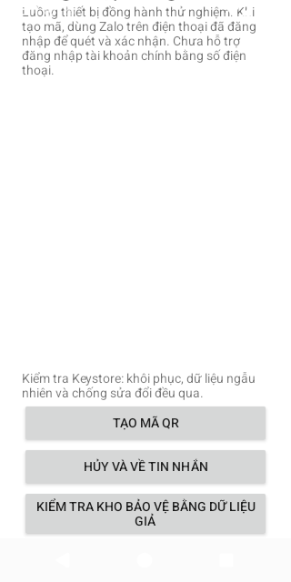

# Android companion QR wiring and Keystore self-test — 2026-11-22

The native Android library now links the shared authentication crate. One generation-scoped Session owner executes companion QR request/scan/confirm/configuration with cancellation and a 240-second outer timeout. Progress carries no credential fields; a bounded QR bit matrix is rendered locally. Credentials are exported once through a separate byte-array call, written by Java only after Keystore AES-GCM protection, and the native temporary byte array is cleared best effort. Native state retains the Session for future transport integration. No Rust file-save path is called by this flow.

The screen has explicit create/cancel controls, progress, a synthetic vault self-test and scrolling for small displays. Backgrounding cancels the current attempt. SessionVault uses a provider-generated IV, versioned envelope, bounded input and AtomicFile in noBackupFilesDir. Failed protection does not write plaintext. See ADR 0010 for references/threat-model limits.

| Check | Result / scope |
| --- | --- |
| Native state fixture | 1 passed: generation isolation, one-shot credential take, cancellation flag and terminal state; no request started. |
| Desktop regression | 381 passed, 2 ignored after extracting in-memory Session serialization. |
| Native Android release | ARM64 and x86_64 libraries built. NDK CC/AR setup added for TLS C objects. |
| Android unit tests | Existing 4 tests per flavor passed; these do not cover live login or Keystore. |
| APK build/install | Both version-code-5 debug APKs built and installed. Initial Java Context error was fixed; final build passed. |
| Internal emulator UI | Opened QR screen without creating a QR. Small-screen clipped controls were fixed with scrolling. |
| Keystore runtime | Synthetic roundtrip, different ciphertext on repeated write and tamper rejection passed. Separate test alias/file removed afterward; no_backup listing was empty. |
| Cancel navigation | Returned to Messages from idle QR screen. Cancellation of an actual remote request remains untested. |
| Windows release | Passed; EXE 83,090,236 bytes, SHA-256 `E16B5C66CA5171FEF740115D66987A1E7306BBB05BADBACB5ECB69ECDFA872E5`. |

Final local APKs:

- Fork: `android/app/build/outputs/apk/fork/debug/app-fork-debug.apk`, 14,107,586 bytes, SHA-256 `49B586761D9F048F3AFABF7DAA1807D279672260C3B553621D0DFAAB8A86EE47`.
- Internal: `android/app/build/outputs/apk/internal/debug/app-internal-debug.apk`, 14,107,618 bytes, SHA-256 `88ECEC4CAE8A4ECDAFC9105A92E2CE6343C81753401ED7FBC10E8B0C526DE571`.

Not verified: request/QR image interoperability with Zalo, actual scan/confirmation, native TLS on device, completed-session persistence, save/cancel races, restoring a Session after restart, contact/chat sync/send, fork runtime Keystore parity, real device and cross-install key invalidation. No true account, generated QR ticket or message send was used. Do not claim Android authentication is working end to end, primary-mobile login support, release readiness or a performance improvement. Hardware-backed keys are not claimed. New RAM/CPU/network measurements remain missing; package growth is recorded rather than hidden. Debug APKs remain local, not published.
