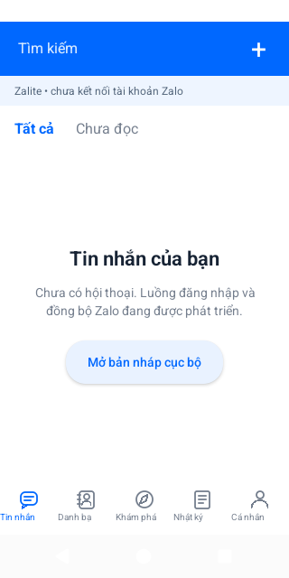

# Android layout correction and GIF index — 2026-11-22

The user corrected the priority: the Android app must resemble a mobile chat client rather than open on a utility form. References inspected: [official Zalo Google Play page](https://play.google.com/store/apps/details?hl=vi&id=com.zing.zalo), [official Android help](https://help.zalo.me/doc-tag/android/page/9/), and publicly indexed Zalo Android screenshots. Older screenshot variants are not treated as proof of pixel-exact current UI.

The default screen now has a blue search header, message filters and five bottom tabs. GIF/templates live behind the utility entry. Tabs show honest disconnected states; no fixture chats are represented as live conversations. A local draft screen has a header, full-width multiline composer and a separate tools row. The shell uses drawn vector glyphs and system insets; an observed bottom-bar overlap was fixed and rechecked. This is an initial shell, not a completed Zalo-equivalent interface.

The accompanying gallery work adds cached background indexing, name/tag search, favorites, deterministic ordering, 12-row pagination, name/tag editing and confirmed deletion. Only selected GIFs decode. Three JVM tests cover reachability of 100 entries without duplication, Unicode/tag/favorite filters and stable ties, and page clamping after filtering/deletion. The existing UpdateClient test also passed in each variant (4 tests per variant, 0 failures). These tests do not verify complete UI or network behavior.

Both final debug APKs (version code 4) assembled and installed successfully on emulator-5554. Internal shell rendering and navigation to tools were observed; final screenshot is below. The local-draft screen opened on the preceding icon build; draft persistence, keyboard overlap, full GIF rename/favorite/delete flows, all five final tabs and fork full UI parity remain unverified. Initial UI dumps immediately after install returned null roots; later dumps succeeded, and stale XML was not used as final evidence.

- Fork APK: 3,655,478 bytes, SHA-256 `34BD5417A9500D602421954299C1DD02048C34212473440FB377652144771E16`.
- Internal APK: 3,655,510 bytes, SHA-256 `48CE15BE49D9F3B4B5DDFD8CF431416023183F8AED3AFACC1AA4BF3C21136188`.
- Files: `android/app/build/outputs/apk/{fork,internal}/debug/app-{fork,internal}-debug.apk`.

Open requirements: actual Android Session/login, real conversations/contacts, network send/receive, media transport, account security, faithful populated chat/list layout, release signing and distribution, native-device/performance/network testing. No real account used and no APK release published. Windows source was untouched in this checkpoint; no Windows rebuild is claimed.
