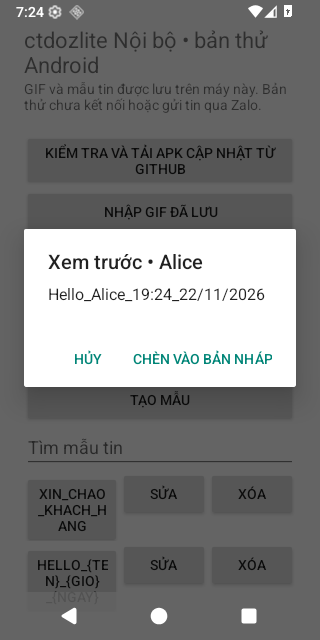
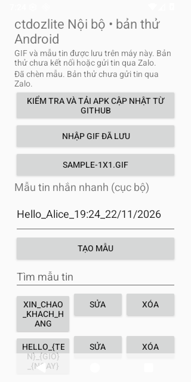

# Shared template expansion and two APKs — 2026-11-22

The one-pass `{ten}`/`{gio}`/`{ngay}` expansion now lives in the portable Rust core. Windows delegates to it and Android calls it through a bounded JNI adapter. Android prompts for a local recipient name, renders the expanded preview and requires confirmation before appending to the local draft. It does not send through Zalo.

| Check | Evidence |
| --- | --- |
| Core tests | 3 passed, including replacement values containing tokens, unknown tokens, Unicode and empty replacement. |
| Windows quick-message regression | 13 matching tests passed; no real Session. |
| Android native build | ARM64 and x86_64 release libraries compiled. |
| Android Gradle | Both variants assembled; one UpdateClient test passed per variant. Initial restricted run failed to connect to localhost daemon; allowed offline run succeeded. |
| Emulator install | Both version-code-2 APKs installed with `adb install -r`, both apps launched. |
| Internal end-to-end flow | Created `Hello_{ten}_{gio}_{ngay}`, entered `Alice`, observed `Hello_Alice_19:24_22/11/2026`, confirmed insertion and observed exact draft text. |
| Fork UI | Launched successfully; complete preview flow not separately exercised. |
| Windows release build | Passed; EXE 83,104,238 bytes, SHA-256 `0B93F1959F4AD30499C29DABE142DAC091A23B02A41353AE7001F2168203C31F`. |

APK artifacts are debug builds only (both ABIs included), not GitHub releases:

- Fork: `android/app/build/outputs/apk/fork/debug/app-fork-debug.apk`, 3,567,093 bytes; SHA-256 `FEB37E5737E73746056959BAE7EF94A50D94C00AC0BB4D54E3B84D9144C12E79`.
- Internal: `android/app/build/outputs/apk/internal/debug/app-internal-debug.apk`, 3,567,101 bytes; SHA-256 `D3FC595B1AF92AF09561D72403342CAAD6E6C24D79207F7B287EE11371511B66`.

Open: Android Zalo login/chat/send, release signing and distribution, GIF send, encrypted portable backup, full parity of both variants, native-device testing, cancellation and invalid-name UI cases, performance/network sampling. Existing 100-template/120-character mobile limits remain; they are local prototype limits, not Zalo entitlements. No real Zalo account was used.
