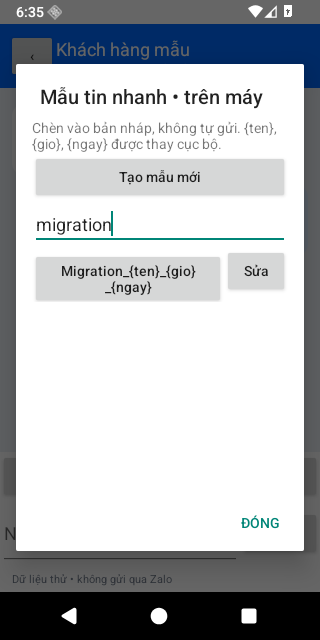
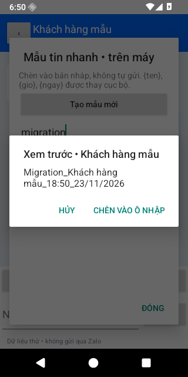
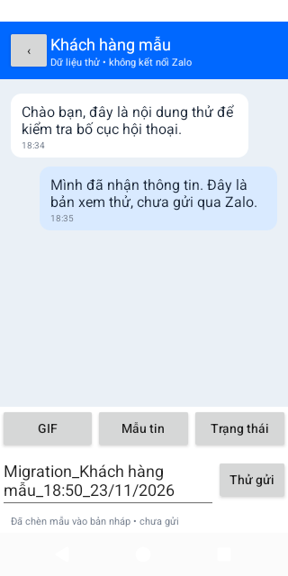
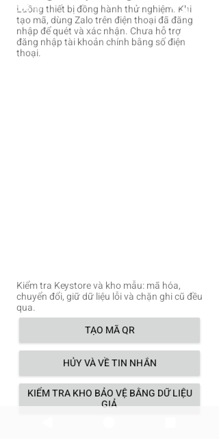

# Android: mẫu tin trong hội thoại và kho mã hóa — 2026-11-23

## Thay đổi

- Nút Mẫu tin mở bộ chọn ngay trong chat: tìm có/không dấu, tạo, sửa và xem trước. Tên người nhận được lấy từ hội thoại hiện tại; biến tên/giờ/ngày được thay bằng hàm Rust dùng chung. Chỉ chèn vào vị trí đang chọn, không tự gửi.
- Chặn chèn khi đổi hội thoại, đổi phiên, tái tạo composer hoặc bản nháp đã khác. Không cắt giữa cặp surrogate emoji; không cắt ngầm nội dung vượt 4.000 đơn vị UTF-16. Ra nền đóng các hộp mẫu đang mở.
- Kho mẫu chuyển sang Keystore AES-GCM + AtomicFile, alias/tệp riêng với Session. I/O trên executor nền, kiểm tra revision trước ghi và đọc/xác minh sau ghi. UI chỉ nhận danh sách mới khi xác minh xong. Lỗi mở kho kết thúc loading và cho thử lại.
- Di chuyển từ SharedPreferences sau khi kiểm tra toàn bộ dữ liệu; chỉ bỏ khóa cũ sau khi kho mới đọc lại đúng. Lỗi định dạng giữ nguồn, dữ liệu hai nguồn khác nhau giữ cả hai, ciphertext hỏng không bị đặt thành kho trống để ghi đè.

## Bằng chứng

| Kiểm tra | Kết quả |
| --- | --- |
| JVM | 17 bài mỗi flavor qua; 3 bài mới cho chèn/thay vùng chọn, bản nháp đổi, giới hạn, emoji/vị trí sai. |
| APK | Hai debug APK versionCode 10 build sạch thành công. JNI Rust/ABI dùng lại từ v9, không đổi nguồn Rust. |
| Di chuyển thực tế | Trên v9 tạo mẫu giả `Migration_{ten}_{gio}_{ngay}` qua UI, xác nhận khóa plaintext/marker có tồn tại. Sau nâng lên v10: khóa `templates` không còn; `templates-vault.bin` tồn tại và không chứa marker plaintext; cả ba mẫu cũ hiện trong bộ chọn. |
| Chèn thực tế | Tìm `migration`, preview thay tên/giờ/ngày; ảnh lần cuối trước chỉnh UI hiển thị `Migration_Khách hàng mẫu_18:50_23/11/2026`. Xác nhận chèn đúng chuỗi vào ô nhập, nhãn “chưa gửi”, không thêm bong bóng hay gọi gửi. |
| Tạo/sửa | Mẫu rỗng không làm đóng hộp nhập. Tạo `Created_{ten}`, sửa thành `Edited_{ten}`, danh sách cập nhật sau ghi kho thành công. |
| Ra nền | Mở preview chưa chèn, xác nhận Launcher foreground, mở lại: popup đã đóng, bản nháp Migration trước đó không bị thêm Edited. |
| Khởi động lại | Force-stop riêng app thử, mở lại và tìm được `Edited_{ten}` từ kho mã hóa. Bản nháp RAM không được tuyên bố lưu qua process death. |
| Keystore/repository runtime | Tự kiểm tra riêng bằng dữ liệu giả qua: legacy sai giữ nguồn/không tạo vault, di chuyển đúng/xóa khóa cũ, stale revision bị chặn, hai nguồn khác nhau giữ nguồn, ciphertext không lộ marker, tamper bị từ chối và tệp lỗi được giữ. Test alias/file/prefs riêng được dọn; kho mẫu thực vẫn còn. |
| Windows | Không sửa hay build lại Windows/lõi Rust ở mốc này; không ghi kết quả cũ là kiểm tra mới. |

Ảnh dưới đây dùng dữ liệu giả, chụp trước bước chỉnh thanh công cụ cùng ngày. Giao diện và APK cuối xem [báo cáo đối chiếu Android](2026-11-23-android-visual-refinement.md). Không có tài khoản hay tin Zalo thật:

## Phần chưa đạt

Giới hạn cũ 100 mẫu/120 codepoint vẫn là hạn chế của bản thử, chưa đạt yêu cầu thư viện lớn/phân nhóm/đính kèm/nhập xuất/sao lưu di động. Chưa có kiểm thử với tài khoản thật, gửi mẫu qua Zalo, thiết bị ARM64 thật, mất điện/đầy đĩa, mất khóa, phục hồi sau gỡ app hay review độc lập. Mã hóa kho mẫu không mã hóa toàn bộ chat, GIF, bản nháp cũ hoặc bản xuất; bỏ khóa preference cũ không phải secure erase. Không phát hành APK. Tổng thể mục tiêu vẫn đang thực hiện.
