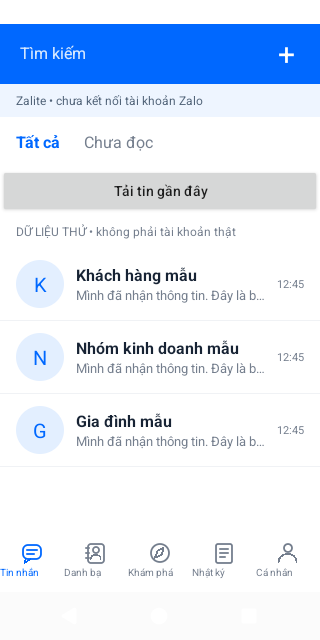
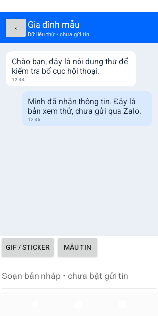
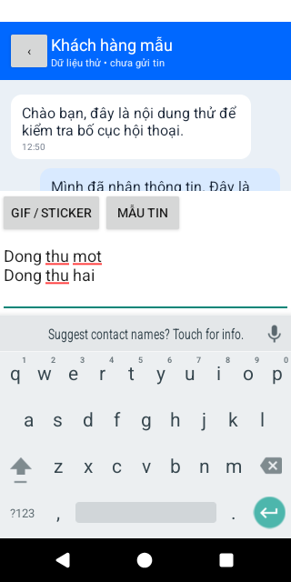

# Android: hội thoại gần đây và màn hình chat — 2026-11-23

Mốc này tiếp tục sửa việc Android chỉ mở một trang tiện ích. Đã đối chiếu lại [trang Zalo Android chính thức](https://play.google.com/store/apps/details?id=com.zing.zalo&hl=vi) và [hướng dẫn thanh nhập/GIF của Zalo](https://help.zalo.me/huong-dan/chuyen-muc/nhan-tin-va-goi/nhan-tin/gui-tin-nhan-da-phuong-tien-va-mien-phi-voi-zalo/). Giao diện hiện chưa đạt mức giống hoàn chỉnh.

## Hành vi đã triển khai

- Nút tải tin gần đây chạy nền qua chính Session/transport Rust dùng chung với Windows. Không có phiên thì trả yêu cầu đăng nhập trước khi tạo yêu cầu mạng; có thời hạn 30 giây và chặn kết quả thuộc phiên cũ.
- Danh sách hội thoại và bong bóng tin đến/đi, tên/giờ/trích đoạn; tên chưa biết dùng mã liên hệ, không tạo trạng thái online hoặc xác nhận đã gửi giả.
- Tìm trong tên và tin cuối đã tải, có/không dấu tiếng Việt. Từ khóa không gửi ra mạng.
- Bản nháp hội thoại nhiều dòng trong RAM, tách nhóm/chat riêng, xóa khi đổi tài khoản. Chưa có nút gửi tin Zalo.
- Bản debug có nút mở dữ liệu mẫu và nhãn rõ trên danh sách/màn hình chat. Đây không phải bằng chứng đọc được tài khoản thật.
- Bộ chiếu dữ liệu giới hạn 5.000 mục/10.000 tin đầu vào, 512 hội thoại, 100 tin mỗi hội thoại, 4.000 ký tự mỗi tin và 512 KiB tổng chữ. Nội dung bị cắt được ghi dấu giới hạn. Không tự tải URL/ảnh đại diện/tệp đính kèm. Giới hạn áp dụng sau khi Session nhận JSON; chưa chặn byte phản hồi HTTP từ đầu.
- Thiếu khóa mã hóa không còn chuyển sang yêu cầu plaintext cho endpoint này. Bằng chứng giao thức và phạm vi thay đổi ở ADR 0012/re-notes tương ứng.

## Kiểm chứng

| Kiểm tra | Kết quả / giới hạn |
| --- | --- |
| Rust Windows | 382 bài qua; 2 bỏ qua; không lỗi. |
| Ma trận bảo mật | 4 hàm test chạy 1.024 tình huống; đều qua. Không gọi đó là 1.024 hàm test. |
| Auth Rust dùng chung | 65 bài qua, gồm 7 bài bộ chiếu và 1 bài chặn thiếu danh tính/khóa trước mạng. |
| JNI native | 2 bài qua; đã mở rộng kiểm tra snapshot/phiên hiện hành/hủy và không trả Session đã hủy. |
| Android | 7 bài JVM mỗi biến thể qua: 3 tìm hội thoại, 3 GIF, 1 cập nhật. Native ARM64/x86_64 build thành công. |
| Giả lập nội bộ | Không có vault; mở danh sách mẫu; tìm `gia dinh` trả đúng `Gia đình mẫu`; mở chat có bong bóng hai phía; nhập được hai dòng. |
| Bàn phím | Phát hiện cửa sổ bị pan làm khuất header; thêm `adjustResize`, build/cài lại. Kiểm tra lại với bàn phím ảo thực sự mở (`mInputShown=true`, `mIsInputViewShown=true`): header ở y32–80, ô nhập y258–346, đều còn trong vùng hiển thị. Cấu hình bàn phím giả lập đã trả về giá trị 0 ban đầu. |
| Đóng gói | Phát hiện khoảng 6 MB thừa trong APK Fork sau incremental packaging. Chạy clean/assemble cả hai; không sửa ZIP hay chữ ký thủ công. |
| Windows release | Build qua; 83.074.488 byte; SHA-256 `77559CF44B5E78ABE634077E1498010AA49E37FC1F2343682754A73FA42117BD`. |

Lượt UI chạy trong giả lập nhỏ 320×640, có thời điểm chạy đồng thời với build Windows. Mẫu bộ nhớ nội bộ khi mở chat mẫu: TOTAL PSS 49.568 KiB, RSS 180.428 KiB (dumpsys meminfo); không phải benchmark idle hay so sánh với Zalo chính thức. CPU nền, cache/đĩa cài thực và byte mạng trước/sau chưa đo. Không lấy số cũ gán cho bản này.

Hai APK debug cuối (versionCode 7), đã cài lên emulator-5554:

| Gói | Byte | SHA-256 |
| --- | --- | --- |
| `android/app/build/outputs/apk/fork/debug/app-fork-debug.apk` | 14.582.993 | `D8DC1764C0C0C243CA543DCC60B374E34251FCE2E6E4A044A7F3EC5582B7ACDB` |
| `android/app/build/outputs/apk/internal/debug/app-internal-debug.apk` | 14.582.997 | `D66DC528C7EC24941364A77DA2082D5FE52BFA60721D0F6D3EF13B4705F8ADFE` |

Đây là gói thử cục bộ, không phải release. Nguồn cập nhật hai biến thể vẫn riêng biệt như cấu hình trước; chưa có APK release ở hai kênh để chứng minh cập nhật đầu cuối.

## Cổng còn mở

Chưa quét/xác nhận QR bằng tài khoản thật; chưa chứng minh API tải được hội thoại sau đăng nhập, tên/danh bạ, lịch sử đầy đủ, socket, gửi tin, gửi GIF hay khôi phục phiên thật. Mẫu JSON chỉ là fixture tổng hợp, cần đối chiếu phản hồi xác thực được phép. Chưa có kiểm thử trên thiết bị thật, review độc lập, mã hóa chat lưu bền, benchmark đầy đủ hay ký release. Không phát hành APK. Build có cảnh báo API Android cũ, Gradle deprecated, strip thư viện không thành công; Windows có cảnh báo unused_mut đã tồn tại. Không tuyên bố các cổng này đã qua.
