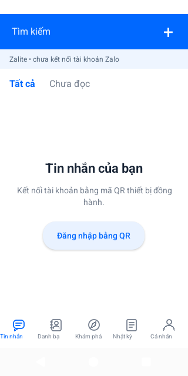

# Android in-memory restore and no-account QR request — 2026-11-23

The protected vault is read on a background thread when the Activity starts/resumes. A fresh Rust Session receives decrypted bytes directly, without a plaintext file. Native validation rejects malformed input, oversized bytes, missing/invalid identity, wrong key length and a Session explicitly marked expired. Failure preserves the existing owner/state. Successful local restore is labeled `restored_unverified` and does not claim the server accepted its credentials. File corruption/decryption failure keeps the original vault for recovery. The startup existence check also includes AtomicFile's legacy `.bak` recovery path.

| Check | Result / scope |
| --- | --- |
| Native tests | 2 passed: synthetic valid/invalid/expired/wrong-key decode and generation/one-shot/cancellation behavior; failed restore does not replace previous state. |
| Root library regression | 381 passed, 2 ignored, 0 failed. |
| Native ARM64 and x86_64 | Built and packaged. |
| Android tests/build | Four existing JVM tests per flavor passed; both version-code-6 APKs built/installed. |
| Startup without vault | Internal app opened as disconnected; no false login success or forced network request. |
| Actual no-account QR request | Internal emulator app reached `waiting_scan` and displayed “Chờ quét mã bằng Zalo trên điện thoại.” This follows successful matrix rendering in the UI. The QR was not scanned, confirmed or captured in a committed image. |
| Cancel | Cancel returned to Messages; no_backup directory was empty afterward. This was an actual waiting-scan request, unlike the prior idle-only check. |
| Stop/reopen with no vault | Force-stopped only the test app, reopened and observed disconnected Messages. |
| Windows release | Passed: EXE 83,073,597 bytes, SHA-256 `A727B6D683451338EBDBC8BC3B884DCC935395675C04B783575CD8E40806DB62`. |

The emulator was initially absent; the existing test AVD was booted. Under simultaneous build load, System UI reported one ANR; choosing Wait recovered it. This is recorded rather than attributed to successful app responsiveness. An immediate UI dump after restart returned null; a later dump of the same running app provided the result. No benchmark improvement is claimed, and RAM/CPU/network bytes remain unmeasured for this build.

Final local debug artifacts:

- Fork APK: 14,367,098 bytes; SHA-256 `83646ED1AA50350F5F08FF7AA2BE21B626E856DAF85BF1C8020471E6337C58E3`.
- Internal APK: 14,367,130 bytes; SHA-256 `C7CC6298CD4A188C111568BF39EE89A42E6A8A882465EBF2F6AE666B27506E96`.
- Paths: `android/app/build/outputs/apk/{fork,internal}/debug/app-{fork,internal}-debug.apk`.

Still unverified/incomplete: completed QR authentication, protected save with real credentials, reopening an app with a valid protected Session, remote Session validation/refresh, key invalidation recovery, background races, restored HTTP transport, contacts/history/socket/send, full fork runtime parity and release signing. Tests validate local decoding separately from the prior Keystore synthetic runtime test; they do not prove the complete real-session restart path. No real Zalo account, QR scan, confirmation, message or APK release used. The goal remains incomplete.

The previous source push failure was resolved during this checkpoint: GitHub accepted `6f3311a` on retry, advancing main from `b0a4552`. The new restore source is a separate commit.
