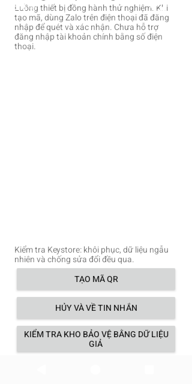
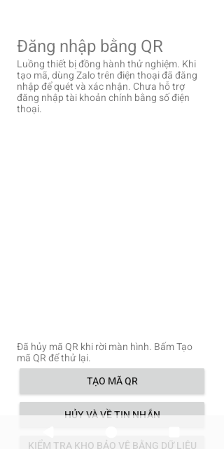

# Android: giữ phiên và vòng đời tác vụ — 2026-11-23

## Lỗi và thay đổi

1. Sau nhánh QR thành công, nút quay về Tin nhắn vẫn gọi `cancelAuth`, làm xóa Session trong RAM. Đã tách điều hướng sau xác thực khỏi hủy QR đang chạy. Ra nền sau bước xác thực không còn dùng tay nắm QR để xóa Session; lưu thất bại được báo rõ chỉ còn phiên tạm.
2. Tác vụ đọc vault cũ có thể thay Session đã cài vào bộ nhớ. Một assertion mới tái hiện lỗi trên mã cũ (`already_present` không được trả về). Sau sửa, việc cài phiên yêu cầu revision còn đúng và owner trống/không đăng nhập; dữ liệu cũ, thiếu token hoặc đang bận bị từ chối.
3. Hủy tải tin được tách thành revision riêng. Ra nền/đổi màn hình làm kết quả UI cũ hết hiệu lực; hủy tải tin vẫn giữ danh tính Session. Các instance vault dùng chung khóa ở luồng nền và kiểm tra phiên trước khi ghi; tệp vẫn AES-GCM + AtomicFile, không có fallback plaintext.
4. Kiểm tra mã thấy hủy do `onStop` không dọn bitmap hoặc bật lại nút tạo QR. Đã xóa bitmap, mở lại nút thử lại khi hủy, đánh dấu native kết thúc ngay và bỏ sự kiện đến muộn. Lượt Home/mở lại quá nhanh vẫn hiện “Chờ quét” và `enabled=false`, nhưng chưa chứng minh Activity đã thật sự chạy `onStop`; không dùng quan sát này để khẳng định tái hiện hủy.
5. Script build dùng target-dir Rust cố định khớp đường dẫn sao chép `.so`, luôn clean phần đóng gói APK để tránh phần thừa quan sát ở mốc trước.

## Kiểm tra tự động

| Phạm vi | Kết quả |
| --- | --- |
| Native Rust Android | 3 bài qua; kiểm tra decode/expiry/key/token, chống restore ghi đè, stale generation, one-shot, hủy đọc giữ Session và không công bố sự kiện sau hủy. |
| Android JVM | 9 bài mỗi biến thể qua, gồm 2 bài mới cho callback sau stop/resume/đổi màn hình. |
| Native build | ARM64 và x86_64 qua. |
| APK | Hai biến thể debug versionCode 8 build sạch thành công. |
| Windows | Không sửa nguồn Windows/lõi giao thức trong mốc này; EXE và kết quả 382 bài ở mốc trước không được ghi là build/test mới. |

## Thử trên giả lập

Giả lập `emulator-5554`, không có vault tài khoản thật. Hai APK cài được; bản nội bộ mở ở trạng thái chưa kết nối. Self-test Keystore chạy thành công, gồm adapter thứ hai thử ghi dữ liệu cũ với điều kiện từ chối, roundtrip, IV/ciphertext khác nhau và từ chối sửa đổi. Thư mục no_backup rỗng sau tự dọn.

Self-test cũng đã chạy lại thành công trên APK Fork cuối; ảnh dưới lấy từ lần đó. No_backup của bản Fork vẫn rỗng sau kiểm tra.

Lượt QR chưa quét đạt “Chờ quét mã bằng Zalo trên điện thoại”. Lượt Home/mở lại liền nhau chưa đủ chứng minh `onStop`. Sau đó đã xác nhận riêng Launcher ở foreground (`topResumedActivity=com.android.launcher3`), rồi mở lại: thông báo “Đã hủy mã QR khi rời màn hình”, nút tạo QR có `enabled=true`, không còn bitmap QR. Bấm tạo lại thực sự đạt waiting-scan; hủy về Tin nhắn thành công và no_backup vẫn rỗng. Không quét hoặc xác nhận mã nào. Một ảnh được lấy trước khi xác nhận hủy đã bị xóa khỏi workspace, không đưa vào Git; chỉ ảnh sau hủy được giữ.

Hai APK cuối đã cài lên giả lập:

| Gói debug, versionCode 8 | Byte | SHA-256 |
| --- | --- | --- |
| `android/app/build/outputs/apk/fork/debug/app-fork-debug.apk` | 14.607.537 | `FAA62EC441532D2FF3F382957CA4B8D5458E4458C200A212FB1419C5AC9C2A46` |
| `android/app/build/outputs/apk/internal/debug/app-internal-debug.apk` | 14.607.541 | `7B2CE357C46FE8B56DA404DDDE9F4EB9DF9E536C3F5674F9D6353EF99E3CA3EF` |

Mẫu sau khi hủy QR, ở trang Tin nhắn chưa kết nối: PSS 45.111 KiB, RSS 172.100 KiB. `du -sk` riêng thư mục files/cache/no_backup lần lượt 24/8/8 KiB; no_backup không có tệp, con số vẫn gồm block thư mục. Đây là profile thử đã dùng trước đó, không phải fresh install hoặc benchmark so sánh với Zalo chính thức.

Mẫu CPU foreground: cùng PID 3851, đọc utime+stime trong `/proc/3851/stat` bằng UID ứng dụng, `CLK_TCK=100`, cửa sổ 20,155 giây; tăng 0 tick, tức không ghi nhận CPU trong độ phân giải 10 ms ở khoảng đó. Không suy ra ứng dụng luôn dùng 0% CPU. Sau đó PID vẫn 3851 và stat hợp lệ. Bản Fork cuối cũng mở được ở trạng thái chưa kết nối; không dùng tài khoản thật ở cả hai biến thể.

Mẫu nền sau khi đưa bản Fork lên trước (bản nội bộ ở nền): cùng PID 3851, utime+stime 668 → 668 tick trong 20,172 giây; không ghi nhận tăng CPU. PSS nền 38.828 KiB, RSS 166.936 KiB. Hai cửa sổ ngắn này không đo GPU, CPU của hệ thống, byte mạng hay workload tài khoản có tin nhắn.

Cấu hình: Android 16/API 36, x86_64, màn hình vật lý giả lập 320×640. Số liệu dạng máy đọc: [android-v8-no-account.json](metrics/android-v8-no-account.json).

## Giới hạn

Chưa hoàn tất đăng nhập bằng tài khoản thật, chưa kiểm chứng giữ phiên sau QR thành công/khởi động lại với phiên thật hay đọc/gửi tin Zalo. Thử vault bằng dữ liệu giả không thay thế kiểm chứng luồng đó. Chưa có review độc lập, stress đồng thời nhiều Activity với tài khoản thật, máy Android thật hay ký/phát hành release. Byte mạng chưa đo; chưa có benchmark trước/sau với cùng workload. Số đo ở mốc trước không được gán cho bản mới. Mục tiêu tổng thể còn mở.
