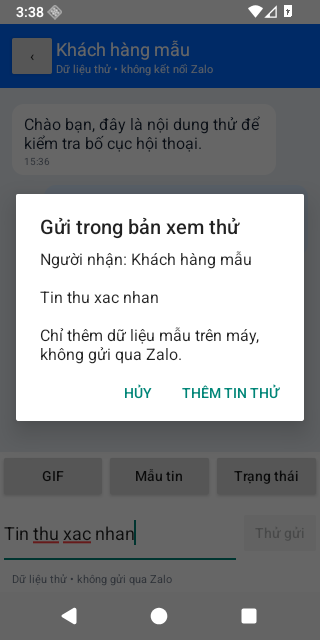
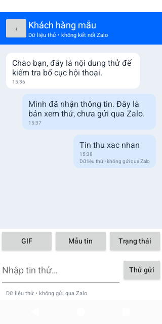

# Android: luồng xác nhận gửi văn bản — 2026-11-23

## Đã triển khai

- Dùng chung transport POST gửi văn bản chat riêng/nhóm với Windows. Giữ nguyên mã hóa Session, domain/cookie guard, trường dữ liệu và client ID. Windows tiếp tục xử lý định dạng chữ trước khi gọi transport; Android gửi chữ nguyên văn.
- Android có bước chuẩn bị và xác nhận tài khoản/người nhận/mã liên hệ hoặc nhóm/nội dung. Tên hiển thị bỏ ký tự điều khiển/đổi hướng chữ/ngắt dòng Unicode và giới hạn 160 codepoint; mã nhận được native kiểm tra riêng. Chỉ nút xác nhận mới POST, không tự gửi khi chèn mẫu hoặc gõ Enter.
- Mỗi xác nhận dùng một client ID, không xác nhận lại cùng lượt. Sổ lượt gửi trong RAM tối đa 32 mục, một POST đang chạy, xem trước hết hạn sau 120 giây. Không phải quyền hay hạn mức phía Zalo.
- Sai phiên, thiếu khóa, sai người nhận hoặc nội dung không hợp lệ bị chặn. Tin có kết quả chưa rõ không tự gửi lại; cùng nội dung/người nhận trong cùng revision bị chặn tạo lượt trùng. Có nút đọc lại trạng thái khi trở về màn hình.
- Chỉ phản hồi mã `0` kèm định danh tin nhắn máy chủ hợp lệ mới được coi là xác nhận transport; không hiển thị Đã nhận/Đã xem. Phản hồi rỗng, lỗi mạng hoặc timeout giữ trạng thái chưa xác định. Sổ này không tồn tại sau khi đóng tiến trình.
- Chế độ mẫu có hộp xác nhận riêng, thêm bong bóng với nhãn “Dữ liệu thử • không gửi qua Zalo”; nhánh này không gọi JNI gửi. Khung xem giữ tối đa 100 tin, không tự mở lại hội thoại cũ khi kết quả về.

## Bằng chứng kiểm tra

| Kiểm tra | Kết quả |
| --- | --- |
| Windows lib | 383 bài qua, 2 bỏ qua. Bao gồm fixture 9 POST cục bộ bảo toàn client ID qua các biến thể/fallback và guard thiếu danh tính/khóa. |
| Ma trận bảo mật | 4 hàm test kiểm tra 1.024 tình huống, đều qua. |
| Rust auth/protocol | 74 bài qua, gồm 7 bài sổ gửi và 1 fixture HTTP giải mã/đối chiếu chính xác 4 POST. |
| Fixture transport | Chat riêng/nhóm, chữ Unicode nguyên văn, thuộc tính định dạng truyền qua, client ID, mã lỗi 114 và thiếu ACK. Chỉ localhost, dữ liệu giả. |
| Lỗi được tái hiện | Test mới cho zero-code keepalive đã thất bại Accepted thay vì Unknown trước sửa, rồi qua sau sửa. |
| Host guard | Lần fixture chạy dạng integration bị production allowlist chặn. Đã chuyển sang unit-test dùng ngoại lệ localhost cfg(test) sẵn có, không nới bản ứng dụng. |
| JNI native | 3 bài vòng đời phiên qua; hai ABI ARM64/x86_64 build được với send bridge. |
| Android | Bộ test gồm tìm kiếm 3, GIF 3, trạng thái/tên xem trước/bản nháp 5, vòng đời 2, cập nhật 1 mỗi flavor. |
| Windows release | Build qua; 83.104.909 byte, SHA-256 `B1ADA5E2A9D355B104EE9A52206410C0060A67015F7642AE36840A3844A2FC11`. |

Trên giả lập không có tài khoản thật, mở hội thoại mẫu, nhập `Tin thu xac nhan`, xem đúng người nhận/nội dung; hủy giữ nguyên bản nháp; mở lại và xác nhận thêm đúng một tin mẫu; ô nhập được xóa và tin có nhãn cục bộ. Hai APK debug versionCode 9 được cài thử. Ảnh dưới chỉ chứng minh luồng mẫu/UI, không chứng minh API Zalo gửi thành công.

Hai APK cuối đã cài trên giả lập, versionCode 9:

| Đường dẫn | Byte | SHA-256 |
| --- | --- | --- |
| `android/app/build/outputs/apk/fork/debug/app-fork-debug.apk` | 14.794.801 | `9261E0F499F52565BC51ECFF8F3D2875DCDD2152CB70F91ED285E0D109129081` |
| `android/app/build/outputs/apk/internal/debug/app-internal-debug.apk` | 14.794.805 | `78BC683FEF23D3A14B92E9D2FB502762E731683F70ADF0BB41ADFEDC655148D7` |

Bản Fork cũng mở được ở trang chưa kết nối. Ở bản nội bộ, sau ba bong bóng mẫu: PSS foreground 45.876 KiB/RSS 176.032 KiB; sau đưa Fork lên trước, PSS nền 45.929 KiB/RSS 177.276 KiB. CPU nền PID 4907 tăng 695 → 696 tick trong 20,174 giây ở 100 Hz, khoảng 0,05% một lõi. `du -sk` files/cache/no_backup: 24/8/8 KiB; no_backup không có tệp, vẫn có block thư mục. Android 16/API 36 x86_64, màn hình 320×640; đây là profile thử cũ, không so sánh với số ở v8 hoặc Zalo chính thức vì workload khác. Số liệu máy đọc ở [android-v9-synthetic-chat.json](metrics/android-v9-synthetic-chat.json).

## Cổng còn mở

Chưa có đăng nhập thật, tải hội thoại xác thực hay gửi/nhận/đồng bộ echo từ Zalo trên Android. Chưa kiểm tra pop-up gửi thật, đổi tài khoản giữa POST, mất mạng giữa gửi, máy ARM64 thật hoặc khôi phục sổ gửi sau process death. Các trạng thái đã được kiểm bằng fixture/state-machine, chưa phải bằng chứng hành vi máy chủ thật. Chưa có review độc lập hoặc release signing; không phát hành APK. Template/GIF vẫn chưa chèn/gửi trực tiếp từ composer hiện tại; không coi nút mở thư viện là đã hoàn thành luồng đó. Windows giữ hành vi nhận phản hồi cũ, cần audit delivery-state riêng. Không có số đo trước/sau cùng workload với Zalo chính thức hoặc byte mạng cho bản này. Mục tiêu tổng thể chưa hoàn tất.

UI Windows của EXE mới chưa được thử lại bằng tài khoản thật; kết quả Windows trong mốc này là build và kiểm thử tự động/fixture, không phải bằng chứng gửi thật. Cảnh báo unused_mut đã có, Android deprecated API/Gradle và strip thư viện vẫn còn; chưa coi đây là bản đủ cổng phát hành.
