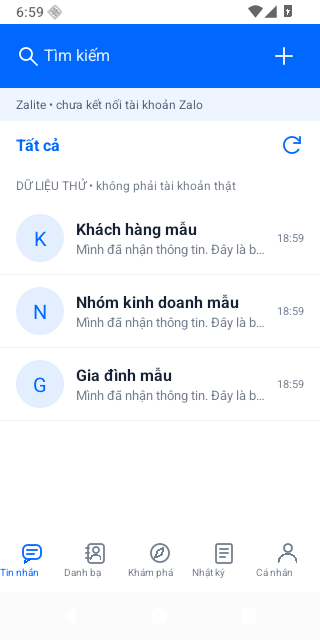
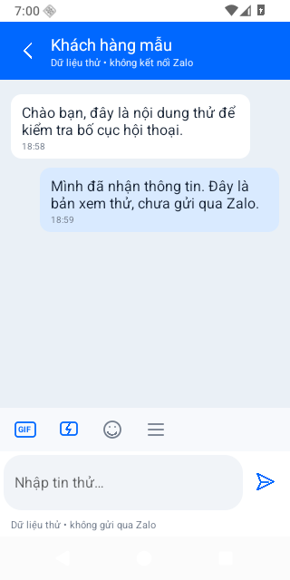
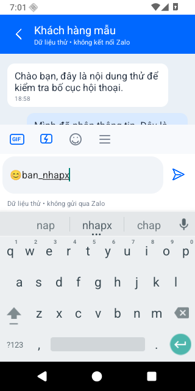

# Android: đối chiếu giao diện Zalo — 2026-11-23

Người dùng yêu cầu Android gần giống Zalo; báo cáo thiếu đăng nhập/gửi tin không thay thế yêu cầu giao diện.

## Tham khảo và thay đổi

Đã tìm và mở [Zalo chính thức trên Google Play](https://play.google.com/store/apps/details?id=com.zing.zalo&hl=vi) cùng liên kết ảnh chụp của nhà phát triển. Tìm thêm ảnh danh sách/chat Android, gồm [hướng dẫn năm 2024](https://9mobi.vn/huong-dan-thay-doi-ten-tai-khoan-zalo-2309n.aspx), chỉ là tham khảo bố cục cũ. Không khẳng định đạt 1:1 phiên bản hiện hành.

- Thêm kính lúp và nút cộng; chuyển làm mới sang biểu tượng, bỏ nút mặc định lớn và nhãn “Chưa đọc” chưa có xử lý.
- Thanh công cụ vector có mô tả trợ năng/tooltip: GIF, mẫu tin, biểu cảm, trạng thái gửi. GIF vẫn mở thư viện tiện ích riêng; chưa gửi GIF trực tiếp từ composer.
- Ô nhập bo tròn tối thiểu hai dòng, nút gửi riêng; giữ xác nhận người nhận/nội dung và nhãn dữ liệu thử. Bộ chọn sáu emoji chèn vào vùng chọn, không tự gửi.
- Nút quay lại gọn; chữ/icon hệ thống tối trên nền trắng. Không thêm thư viện bitmap, font icon hay tải mạng cho icon.
- Bộ chọn mẫu mã hóa vẫn hoạt động từ nút mới. Xem [kho mẫu và di chuyển dữ liệu](2026-11-23-android-composer-templates.md).

## Bằng chứng

Build sạch hai APK versionCode 10 thành công; 17 JVM test mỗi flavor qua, không lỗi hay bỏ qua. Có cảnh báo API cũ, Gradle và không strip được native library. Không đổi Rust/Windows nên không coi kết quả cũ là test mới.

Cài hai APK cuối thành công trên emulator-5554, Android 16/API 36, x86_64, 320×640. Luồng UI cuối thử ở flavor nội bộ; fork chưa được thử lại toàn bộ luồng sau chỉnh UI. Kiểm tra kho bằng dữ liệu giả trên fork đã qua trước bước chỉnh UI.

Đã thử danh sách mẫu → chat → biểu cảm → emoji hiện trong bản nháp → nhập thêm văn bản; mở bộ chọn mẫu từ icon mới thấy bốn mẫu. Lần đầu bàn phím chưa hiện nên không coi là bằng chứng. Sau bật tạm bàn phím ảo cho bàn phím phần cứng, `mInputShown=true`, ảnh có bàn phím thật; header, ô nhập và nút gửi còn trên màn hình. Khôi phục cấu hình giả lập về 0. Không tạo QR, đăng nhập hay gửi tin thật trong bước UI.

Các ảnh cuối đã xem trực tiếp, chỉ có dữ liệu giả:

## Artifact và tài nguyên

| APK debug chưa phát hành | Byte | SHA-256 |
| --- | ---: | --- |
| `android/app/build/outputs/apk/fork/debug/app-fork-debug.apk` | 14811189 | `A28C6BCF2C76406B4F00816407F7F5AC07611B79D9285D259BD3CAFA6457DA9D` |
| `android/app/build/outputs/apk/internal/debug/app-internal-debug.apk` | 14811197 | `696CC49C3B2698BEABE0322D042A5BCE513AEC4AFD24B472F7708467248979A2` |

Một mẫu bộ nhớ khi chat thử trên APK cuối sau emoji: PSS 46.029 KiB, RSS 176.968 KiB. Không phải benchmark nền hay so sánh Zalo. Không có CPU/mạng/cache mới đã xác minh ở bước UI; không dùng số cũ để tuyên bố cải thiện. Kích thước APK không phải dung lượng sau cài/giải nén.

## Chưa đạt

Chưa giống Zalo 1:1: danh bạ/nhật ký/hồ sơ sơ bộ; thiếu avatar thật, ảnh/video lịch sử, gọi thoại/video, sticker đầy đủ, theme tối; chưa thử font lớn, xoay màn hình hay máy ARM64 thật. Chưa kiểm chứng máy chủ bằng tài khoản thật, review độc lập, ký release hoặc phát hành. Giới hạn kho mẫu/nhập xuất/sao lưu vẫn còn. Mục tiêu tổng thể đang thực hiện.
